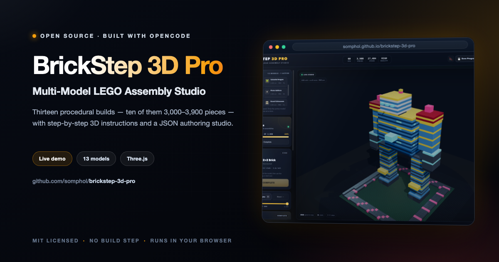
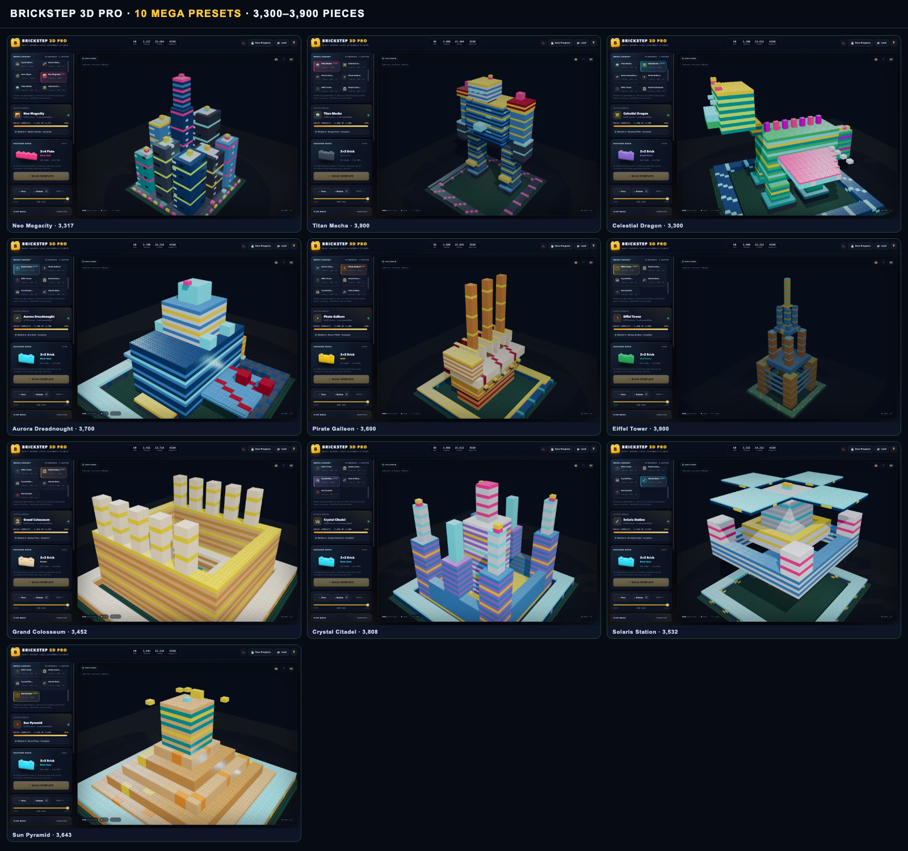

<div align="center">



# BrickStep 3D Pro

**Multi-Model LEGO Assembly Studio**

Thirteen procedural builds — ten of them 3,000–3,900 pieces — with step-by-step 3D instructions, ghost snapping, and a JSON authoring studio.

[](https://somphol.github.io/brickstep-3d-pro/)
[](LICENSE)

**[Try it live →](https://somphol.github.io/brickstep-3d-pro/)**

</div>

---

## The 10 mega presets

| Model | Pieces | Category | Silhouette |
| --- | ---: | --- | --- |
| **Neo Megacity** | 3,317 | Cyber skyline | Nine towers, central spire, bridge, flying car |
| **Titan Mecha** | 3,900 | Giant robot | Layered armor, cannon shoulders, glowing core, hangar deck |
| **Celestial Dragon** | 3,300 | Fantasy creature | Long body, swept wings, horned head, crystal spine |
| **Aurora Dreadnought** | 3,700 | Space battleship | Wedge hull, armor wings, engine bank, neon turrets |
| **Pirate Galleon** | 3,600 | Adventure ship | Layered hull, cream sails, gold masts, side cannons |
| **Eiffel Tower** | 3,900 | Landmark | Four splayed legs, three platforms, lattice bracing |
| **Grand Colosseum** | 3,452 | Landmark | Outer wall, stepped seating, colonnade, arena |
| **Crystal Citadel** | 3,808 | Fantasy castle | Corner towers, sky bridges, luminous keep, spires |
| **Solaris Station** | 3,532 | Orbital station | Concentric rings, hub, solar arrays, docking pods |
| **Sun Pyramid** | 3,643 | Ancient temple | Five stepped terraces, teal sanctuary, gold trim |

Plus three smaller studies: **Castle Workshop** (250), **Aurora Shuttle** (1,099), and **Neon Wyrm** (1,336).



## Lazy loading: one model in memory

- The library stores **metadata and generator functions only** — no brick arrays, matrices, or meshes for inactive models.
- Clicking a model generates **only that model**, builds its instanced batches, and unloads the previous model's batches and placement array.
- Per-model progress is remembered in `modelProgress`, so switching away and back resumes at the same step.
- The active board size is rebuilt per model: 24 × 24 for the classic castle, 48 × 48 for the 1K studies, and 64 × 64 (4,096 studs) for the mega builds.
- Custom authoring stays on its own 24 × 24 board and never loads another preset.

## Highlights

- **Instanced rendering** — one `InstancedMesh` batch per brick type, shared physical plastic material, per-instance colours, shadow mapping and PCF soft shadows.
- **Procedural brick geometry** — 2×4, 2×2, 1×4, and 1×2 bricks and plates with capped top studs and open bottom anti-stud tubes.
- **Guided 250–3,900-step manuals** — progress bar, module badge, required brick bay, step scrubber, previous/next, and clickable sub-assembly modules.
- **Finished preview** — switch **View Mode → Finished**, click the eye in the viewport, or press `V` to see every piece without changing your saved step. Toggle back to **Build** to resume exactly where you left off.
- **Glowing target ghost** — semi-transparent preview with a bright body outline, base ring, vertical locator beam, and floating beacon. Click it, press `Space`, use the Snap button, or drag the brick from the Bay.
- **Snap feedback** — synthesized Web Audio thud/click, a gold shockwave, and a toast.
- **Rotation controls** — `R` rotates the preview 90°; guided snaps auto-align to the instruction orientation, while authoring rotates freely.
- **Explode view** — pull the complete model apart along Y. The camera re-fits the exploded volume when the slider is released, and snapping pauses until you return the slider to 0.
- **Authoring Studio** — build a custom structure on a 24 × 24 plate with all 8 brick/plate types, colour picker, stack-aware ghost, undo, clear, and a 250-piece cap. Export the full step sequence as JSON.
- **Persistence** — active model, per-model step, completed state, placed matrix, custom bricks, explode value, sound preference, and authoring selection are saved to `localStorage`.
- **Portable files** — **Save Progress** downloads `brickstep_pro_250.json` (the filename is kept for compatibility; the payload contains whichever model is active). **Load** restores it on another device. Custom authoring exports `brickstep_custom_250.json`.
- **Responsive studio UI** — desktop three-column studio, tablet two-column layout, and a stacked mobile layout with the 3D viewport above the controls.
- **Extras** — fullscreen, PNG screenshot download, help manual, keyboard shortcuts, live FPS/piece/stud counters, and a confetti completion celebration.

## Run locally

The app is a static site. Open `index.html` directly, or serve the folder:

```bash
cd brickstep-3d-pro
python3 -m http.server 8000
# visit http://localhost:8000
```

Three.js r128 and OrbitControls load from CDNs, so an internet connection is required on first load.

## Controls

| Action | Input |
| --- | --- |
| Orbit / zoom / pan | Left-drag / scroll or pinch / right-drag |
| Snap the current brick | Click the ghost, press `Space`, click **Snap Into Place**, or drag the Bay brick onto the target |
| Next / previous step | `→` / `←` (or `N` / `P`) |
| Rotate preview | `R` or **Rotate** |
| Jump to a step | Step scrubber or a module button |
| Finished preview | `V`, the eye button, or **View Mode → Finished** |
| Explode view | Slider, or `E` to toggle 0% / 60% |
| Focus the target | **🎯 Focus Step** or `F` |
| Reset camera | **⌂ Reset View** |
| Authoring mode | **Enter Authoring Mode**; click the baseplate to stack, `R` to rotate, **Undo / Clear / JSON** |
| Save / load progress | Top-bar **Save Progress** / **Load** |
| Help | `?` or the **?** button |
| Close dialog | `Esc` |

## Save format

Progress files are human-readable JSON and now include a per-model progress map:

```json
{
  "app": "BrickStep 3D Pro",
  "version": "2.0.0",
  "type": "brickstep-progress",
  "modelId": "titan-mecha",
  "modelName": "Titan Mecha",
  "totalSteps": 3900,
  "activeStep": 400,
  "completed": false,
  "placedCount": 399,
  "mode": "guided",
  "explode": 0,
  "customBricks": [],
  "modelProgress": {
    "titan-mecha": { "activeStep": 400, "completed": false },
    "neo-megacity": { "activeStep": 120, "completed": false }
  }
}
```

Custom authoring exports use `"type": "brickstep-custom-model"` and a `steps` array. Imports are sanitized: invalid types, out-of-bounds cells, and overlapping bricks are skipped.

## Performance notes

- One `InstancedMesh` per brick type means the 3,900-piece Titan Mecha still renders in a small number of draw calls.
- Shared geometry is merged once per brick type; only visible matrices are rebuilt when the step, explode value, preview mode, or authoring board changes.
- Mega models use a 64 × 64 instanced baseplate (4,096 studs) and a 2048² shadow map.
- The exploded camera fit includes the vertical explode offset, so large builds stay in frame.
- FPS depends on the GPU. Headless software-rendered captures are much slower than a hardware-accelerated browser.
- Pixel ratio is capped at 2, and exploding is throttled through `requestAnimationFrame`.

## Project structure

```text
brickstep-3d-pro/
├── index.html                  # Studio shell, model library, HUD, help, completion
├── style.css                   # Studio design system and responsive layout
├── script.js                   # Preset generators, Three.js engine, state, UI, audio
├── screenshot.png              # Titan Mecha hero
├── screenshot-models.png       # Ten mega preset contact sheet
├── screenshot-instructions.png # Neo Megacity mid-build with ghost
├── screenshot-authoring.png    # Authoring Studio
├── screenshot-explode.png      # Titan Mecha exploded
├── README.md
├── STATE.md                    # Build time, token usage, credits
├── state.json                  # Machine-readable build state
├── LICENSE
└── .nojekyll
```

## Browser support

Chrome, Edge, Safari, and Firefox with WebGL enabled. The renderer resizes through `ResizeObserver`; the UI is responsive down to small phones.

## Credits

Built with [OpenCode](https://opencode.ai) and **DeepSeek V4.1 Flash**.

The multi-model generator, procedural brick engine, ten mega sculptures, instruction HUD, finished preview, authoring studio, persistence layer, styling, screenshots, and documentation were created in a single agent session.

## Contributing

Contributions are welcome — bug reports, feature ideas, accessibility improvements, and
documentation fixes alike. Please read [CONTRIBUTING.md](CONTRIBUTING.md) and the
[Code of Conduct](CODE_OF_CONDUCT.md) before opening a pull request.

- **Found a bug?** [Open a bug report](https://github.com/somphol/brickstep-3d-pro/issues/new?template=bug_report.yml)
- **Have an idea?** [Request a feature](https://github.com/somphol/brickstep-3d-pro/issues/new?template=feature_request.yml)
- **Found a vulnerability?** Please follow [SECURITY.md](SECURITY.md) and report it privately.

## Documentation

New maintainers and AI agents should start with **[AGENTS.md](AGENTS.md)**.

| Document | Purpose |
| --- | --- |
| [AGENTS.md](AGENTS.md) | Handoff: commands, architecture, constraints, known issues, continuity |
| [docs/REPRODUCTION.md](docs/REPRODUCTION.md) | Rebuild and verification book |
| [docs/ARCHITECTURE.md](docs/ARCHITECTURE.md) | Module map, coordinates, rendering and persistence contracts |
| [docs/TESTING.md](docs/TESTING.md) | What was actually run, the manual matrix, and known gaps |
| [docs/DEPLOYMENT.md](docs/DEPLOYMENT.md) | GitHub Pages operations, verification URLs, rollback |
| [skills/brickstep-3d-pro/SKILL.md](skills/brickstep-3d-pro/SKILL.md) | Reusable build skill with the source as a byte-identical template |
| [README.md](README.md) | Overview, setup, controls, and architecture |
| [CHANGELOG.md](CHANGELOG.md) | Notable changes and release history |
| [CONTRIBUTING.md](CONTRIBUTING.md) | Local workflow, constraints, and pull request checks |
| [SECURITY.md](SECURITY.md) | Supported versions and private vulnerability reporting |
| [STATE.md](STATE.md) | Build timing, verification record, and token usage |
| [LICENSE](LICENSE) | MIT licence |

## License

MIT © 2026 Somphol Boonjing
