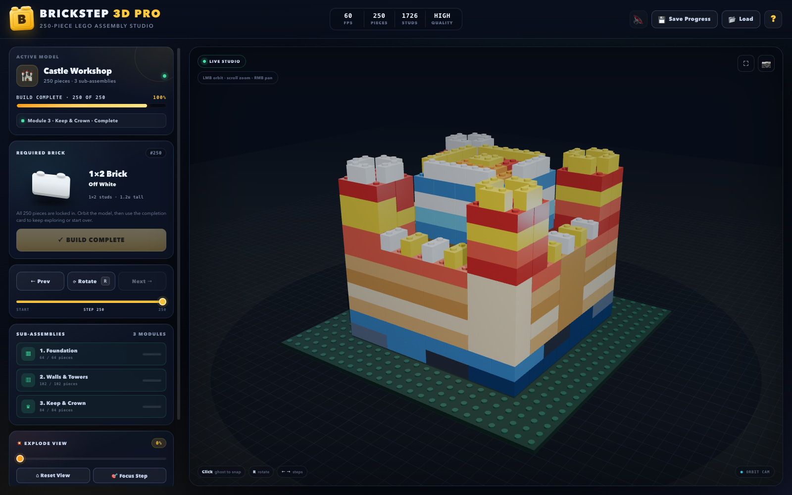

# BrickStep 3D Pro

**A 250-piece LEGO assembly studio with step-by-step 3D instructions, raycast ghost snapping, sub-assembly navigation, explode view, and a JSON authoring studio.**

Built with vanilla HTML5, CSS3, ES6, and Three.js r128. No framework, no build step, no npm install.

**Live demo:** <https://somphol.github.io/brickstep-3d-pro/>



## Highlights

- **Exactly 250 pieces** — a deterministic Castle Workshop generated at runtime from a compact procedural blueprint. 64 foundation pieces, 102 wall/tower pieces, and 84 keep/crown pieces.
- **Instanced rendering** — the built-in model is drawn with a small set of `InstancedMesh` batches, one per brick type, sharing a physical plastic material. The 24 × 24 stud baseplate is also instanced.
- **Real brick geometry** — 2×4, 2×2, 1×4, and 1×2 bricks and plates are built procedurally with capped top studs and open bottom anti-stud receiving tubes.
- **Guided 250-step manual** — progress bar, current module badge, required brick bay, step scrubber, previous/next controls, and clickable sub-assembly modules.
- **Glowing target ghost** — a semi-transparent preview with a bright body outline, base ring, vertical locator beam, and floating beacon. Click it, press `Space`, use the Snap button, or drag the brick from the Bay.
- **Snap feedback** — a Web Audio snap/thud, a gold shockwave ring, a toast, and an automatic camera Focus Step action.
- **Rotation controls** — press `R` or use the Rotate button. Guided snaps auto-align to the instruction orientation; authoring rotates freely in 90° steps.
- **Explode view** — pull the complete model apart along Y with a 0–100% slider. The instruction ghost and snapping pause while exploded so you can inspect the layers.
- **Authoring Studio** — build a custom structure on the 24 × 24 plate with all 8 brick/plate types, a colour picker, stack-aware hover ghost, undo, clear, and a 250-piece cap. Export the full step sequence as JSON.
- **Persistence** — active model, active step, completed state, camera-independent build state, custom brick matrix, explode value, sound preference, and authoring selection are saved to `localStorage`.
- **Portable files** — `💾 Save Progress` downloads `brickstep_pro_250.json`; `📂 Load` restores it on another device. Custom authoring exports `brickstep_custom_250.json`.
- **Responsive studio UI** — desktop three-column studio, tablet two-column layout, and a stacked mobile layout with the 3D viewport above the controls.
- **Extras** — synthesized audio with mute, fullscreen, PNG screenshot download, help manual, keyboard shortcuts, FPS counter, piece/stud counters, and a completion celebration with confetti.

## The 250-piece model

| Module | Steps | Pieces | Contents |
| --- | ---: | ---: | --- |
| **Foundation** | 1–64 | 64 | Two bonded 16 × 16 base courses in slate/navy |
| **Walls & Towers** | 65–166 | 102 | Five sandstone wall courses plus four 4 × 4 red/gold corner towers |
| **Keep & Crown** | 167–250 | 84 | Blue 8 × 8 keep, stepped roof plates, wall and tower merlons, gold crown ring |

The generator validates the final list: **250 placements, zero out-of-bounds bricks, zero overlapping stud cells**.

## Run locally

The app is a static site. Open `index.html` directly, or serve the folder:

```bash
cd brickstep-3d-pro
python3 -m http.server 8000
# visit http://localhost:8000
```

Three.js r128 and OrbitControls are loaded from CDNs, so an internet connection is required on first load.

## Controls

| Action | Input |
| --- | --- |
| Orbit / zoom / pan | Left-drag / scroll or pinch / right-drag |
| Snap the current brick | Click the ghost, press `Space`, click **Snap Into Place**, or drag the Bay brick onto the target |
| Next / previous step | `→` / `←` (or `N` / `P`) |
| Rotate preview | `R` or **Rotate** |
| Jump to a step | Step scrubber or click a module |
| Explode view | Slider, or press `E` to toggle 0% / 60% |
| Focus the target | **🎯 Focus Step** or `F` |
| Reset camera | **⌂ Reset View** |
| Authoring mode | **Enter Authoring Mode**; click the baseplate to stack, `R` to rotate, **Undo / Clear / JSON** |
| Save / load progress | Top-bar **Save Progress** / **Load** |
| Help | `?` or the **?** button |
| Close dialog | `Esc` |

## Save format

Progress files are human-readable JSON. A short example:

```json
{
  "app": "BrickStep 3D Pro",
  "version": "1.0.0",
  "type": "brickstep-progress",
  "modelId": "castle-workshop-250",
  "activeStep": 100,
  "completed": false,
  "placedCount": 99,
  "mode": "guided",
  "explode": 0,
  "customBricks": [],
  "savedAt": "2026-11-01T04:00:00.000Z"
}
```

Custom authoring exports use `"type": "brickstep-custom-model"` and a `steps` array:

```json
{
  "step": 1,
  "type": "2x4b",
  "typeLabel": "2×4 Brick",
  "color": "#c0392b",
  "colorName": "Brick Red",
  "x": 8,
  "z": 8,
  "y": 0,
  "rot": 0,
  "module": "custom"
}
```

Imported custom files are sanitized: invalid types, out-of-bounds cells, and overlapping bricks are skipped.

## Performance notes

- One `InstancedMesh` per brick type for the built-in model (four batches for the castle) plus one 576-stud baseplate batch.
- Shared `MeshPhysicalMaterial` with per-instance colours.
- Shadow mapping is enabled with a 2048² key-light shadow map and PCF soft shadows.
- Geometry is merged once per type, including studs and tubes; matrices are only rebuilt when the step, explode value, or authoring board changes.
- Pixel ratio is capped at 2 for high-density displays.
- The viewport uses `OrbitControls` with damping and a bounded polar angle to keep the model above the stage.

## Project structure

```text
brickstep-3d-pro/
├── index.html                 # Studio shell, HUD, help, completion dialog
├── style.css                  # Dark studio design system + responsive layout
├── script.js                  # 250-piece generator, Three.js engine, state, UI, audio
├── screenshot.png             # Completed build
├── screenshot-instructions.png# Mid-build instruction ghost
├── screenshot-authoring.png   # Authoring Studio
├── screenshot-explode.png     # Exploded layers
├── README.md
├── STATE.md                   # Build time, token usage, credits
├── state.json                 # Machine-readable build state
├── LICENSE
└── .nojekyll
```

## Browser support

Chrome, Edge, Safari, and Firefox with WebGL enabled. The UI is responsive down to small phones; the 3D scene adjusts its renderer size through `ResizeObserver` and fullscreen changes.

## Credits

Built with [OpenCode](https://opencode.ai) and **DeepSeek V4.1 Flash**.

The 3D engine, procedural brick geometry, 250-step model generator, instruction HUD, authoring studio, persistence layer, styling, screenshots, and documentation were created in a single OpenCode agent session.

## License

MIT © 2026 Somphol Boonjing
